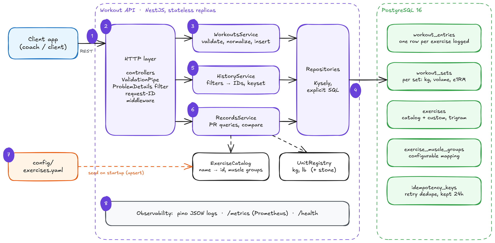

# Workout Logging API

An API that lets coaches track their clients' lifts: log sets in kg or lb, browse workout history, and get personal records (PRs). Built with NestJS 11 (TypeScript), PostgreSQL 16 and Kysely.

Also in this repo:

- [`AI_WORKFLOW.md`](AI_WORKFLOW.md): how AI tools were used, and where they were wrong.
- [`ESTIMATE.md`](ESTIMATE.md): the time estimate next to the actual time spent.
- The [system design doc](https://claude.ai/artifact/Sv5FXFkDRrr7cPFWx52p7z).

## Quick start

```bash
docker compose up --build        # PostgreSQL + API on :3000; migrations and catalog seed run first
curl localhost:3000/health       # {"status":"ok"}
```

Local development (Node 22): `docker compose up -d db`, `cp .env.example .env && export $(cat .env | xargs)`, `npm ci && npm run start:dev`. Run `npm test` for unit + e2e tests (the e2e tests need Docker).

```bash
curl -X POST localhost:3000/users/client-42/workouts \
  -H 'Content-Type: application/json' -H 'Idempotency-Key: 7f1c2a' \
  -d '{"entries":[{"exerciseName":"Bench Press","date":"2026-11-20","sets":[{"reps":5,"weight":225,"unit":"lb"}]}]}'
curl 'localhost:3000/users/client-42/workouts?exercise=bench&unit=kg'
curl 'localhost:3000/users/client-42/personal-records?exercise=Bench%20Press'
```

## Architecture



1. The client calls the REST API with `userId` in the path; writes carry an `Idempotency-Key` header.
2. The HTTP layer validates every request at the boundary (allowed units come from the `UnitRegistry`) and turns any failure into one RFC 9457 error with the request id.
3. `WorkoutsService` resolves exercise names through the `ExerciseCatalog`, normalizes each weight to kg, then writes the idempotency key, entries, sets and the stored response in one transaction.
4. Repositories use Kysely with explicit SQL over a pg pool (`statement_timeout` 2 s). PostgreSQL computes volume and estimated 1RM as generated columns.
5. `HistoryService` turns name and muscle-group filters into exercise ids, reads a keyset page, and converts weights to the requested unit.
6. `RecordsService` reads every PR metric in one statement, one `LIMIT 1` read per metric.
7. `config/exercises.yaml` holds the catalog and the muscle-group mapping. `npm run migrate` upserts it before the API starts.
8. Every request writes one JSON log line with its request id; `/metrics` (Prometheus) and `/health` serve monitoring.

## API

`userId` is a path parameter (1–64 characters: `A-Z a-z 0-9 . _ : -`). There is no authentication.

### `POST /users/:userId/workouts`: log workouts (bulk)

| | |
|---|---|
| Body | `{ "entries": [ { "exerciseName", "date", "timeZone"?, "sets": [ { "reps", "weight", "unit" } ] } ] }` |
| Limits | 1–50 entries, 1–20 sets each, reps 1–1000, weight 0–10000 with at most 2 decimals (0 = bodyweight) |
| `date` | `YYYY-MM-DD` (the client's local day), or an ISO timestamp **with** an offset. No offset → rejected as ambiguous. |
| `unit` | `kg` or `lb` (case-insensitive; aliases such as `lbs`, `kilogram`) |
| `Idempotency-Key` | Optional. A retry returns the stored response with `Idempotent-Replayed: true`. The same key with another body → `422`. |
| `201` | `{ "data": [ { id, exerciseId, exerciseName, date, performedAt, timeZone, sets: [ { setIndex, reps, weight, unit, weightKg } ] } ] }` |

All-or-nothing: every entry is validated before anything is written, and every error comes back with its path. An unknown exercise name becomes a custom exercise for that user.

### `GET /users/:userId/workouts`: history

Query: `exercise` (partial, case-insensitive), `muscleGroup`, `from` and `to` (inclusive local days), `unit` (convert; default is as logged), `limit` (1–100, default 20), `cursor` (from `page.nextCursor`).

Returns `200 { "data": [ { id, exerciseId, exerciseName, muscleGroups, date, performedAt, timeZone, sets } ], "page": { "limit", "nextCursor" } }`, newest first. When nothing matches, `data` is `[]` with a `message`, not an error.

### `GET /users/:userId/personal-records?exercise=…`: personal records

`exercise` must name exactly one exercise. Optional: `from`, `to`, `unit` (default `kg`).

```json
{ "exercise": { "id": "…", "name": "Back Squat" }, "unit": "kg", "range": { "from": null, "to": null },
  "records": {
    "maxWeight": { "value": 140,    "weight": 140, "reps": 1,  "unit": "kg", "date": "2026-09-01" },
    "maxVolume": { "value": 1000,   "weight": 100, "reps": 10, "unit": "kg", "date": "2026-09-01" },
    "bestE1rm":  { "value": 151.67, "weight": 130, "reps": 5,  "unit": "kg", "date": "2026-09-08" } } }
```

- **Formulas:** volume = reps × weight; estimated 1RM uses Epley, weight × (1 + reps/30).
- **Ties:** the earliest date wins.
- **Excluded:** bodyweight (0 kg) sets.
- **No data:** each record is `null`, with a `message`.

### `GET /users/:userId/personal-records/compare`: this period vs the last

Pass `exercise` and `unit`, plus **either** of these:

- `period=month|week` with `timeZone` (IANA, default `UTC`). "Current" runs from the start of the period to today in that zone; "previous" is the whole prior period.
- All four of `currentFrom`, `currentTo`, `previousFrom` and `previousTo`.

Returns `current`, `previous` and a per-metric `delta`. A delta is `null` when either side has no data.

### Errors (RFC 9457, `application/problem+json`)

```json
{ "status": 400, "code": "VALIDATION_ERROR", "title": "Request validation failed",
  "errors": [ { "path": "entries[1].sets[0].unit", "code": "unsupported_unit",
                "message": "unit 'stone' is not supported; use one of: kg, lb" } ],
  "requestId": "01a1fc3f-d069-770a-afb3-e96353857ce0" }
```

| Status | `code` | When |
|---|---|---|
| 400 | `VALIDATION_ERROR` | An invalid body, query, header or path value, or malformed JSON. `errors[]` lists every failure. |
| 400 | `INVALID_CURSOR` | The cursor is malformed, or was issued for different filters. |
| 404 | `EXERCISE_NOT_FOUND` | No such exercise; `suggestions[]` lists close names. |
| 404 | `NOT_FOUND` | Unknown route. |
| 413 | `PAYLOAD_TOO_LARGE` | The body is over 256 KB. |
| 422 | `IDEMPOTENCY_KEY_REUSED` | The same key was sent with a different body. |
| 503 | `SERVICE_UNAVAILABLE` | The database is unreachable, or a query hit the 2 s timeout. Safe to retry. |
| 500 | `INTERNAL_ERROR` | A bug. Details are only in the logs, findable by `requestId`. |

## Database

PostgreSQL over MongoDB: the data is relational (user → entry → set, exercise → muscle groups), a PR is an ordered index read, and `numeric` stores weights exactly.

| Table | Purpose |
|---|---|
| `exercises` | The catalog plus each user's custom exercises; unique on `(owner_user_id, normalized_name)`; trigram index for partial names |
| `exercise_muscle_groups` | Exercise → muscle group mapping, seeded from `config/exercises.yaml` |
| `workout_entries` | One row per exercise logged; uuid v7 `id`; `performed_on` is the local day |
| `workout_sets` | One row per set: value and unit as logged, `weight_kg`, generated `volume_kg` and `e1rm_kg`. `user_id`, `exercise_id` and `performed_on` are copied from the entry, so PR queries need no join. |
| `idempotency_keys` | `(user_id, key)`, request hash and stored response, kept 24 h |

**Normalization.** Weights are stored as sent, plus `weight_kg` (computed once, 5 decimals). PRs compare only the kg columns. A read in the original unit returns the logged value untouched; a read in another unit converts from kg.

| Index | Serves |
|---|---|
| `workout_entries (user_id, performed_on DESC, id DESC)`, plus a variant with `exercise_id` | History keyset pages, with or without filters |
| `workout_sets (entry_id, set_index)` | Loading the sets for a page |
| `workout_sets (user_id, exercise_id, performed_on) INCLUDE (…)` | PRs in a date range |
| `workout_sets (user_id, exercise_id, <metric> DESC, …) WHERE weight_kg > 0`, one per metric | All-time PRs, reading one row each |
| `exercises GIN (normalized_name gin_trgm_ops)` | Partial name match and 404 suggestions |

The benchmark found that ranged PR reads need a `MATERIALIZED` CTE. Otherwise the planner walks the per-metric index and drops rows outside the dates: about 100 ms instead of about 2 ms on 200k sets. The design doc explains why.

## Time zones, concurrency, extending

- **Time zones.** `performed_on` is the client's local calendar day and drives every filter and PR range; instants are stored in UTC. Bucketing UTC timestamps by day at read time would need the user's zone in every query and couldn't use a plain index. It would also put a 06:00 Ho Chi Minh City session on the previous day. The cost: a travelling client's days follow the zone they logged from.
- **Concurrency.** Writes only insert and PRs are computed on read, so concurrent writes never touch a shared row. A retry with the same `Idempotency-Key` blocks on the key's unique index until the first request commits, then replays its response.
- **New unit.** One line in `WEIGHT_UNITS` (`src/units/unit-registry.ts`). Validation, conversion and storage all pick it up.
- **New muscle-group mapping.** Edit `config/exercises.yaml` and restart; migrate re-seeds it. No code change.

## Testing

The project is built test-first (rules in `CLAUDE.md`).

- **Unit tests** cover conversions, dates and cursors.
- **E2E tests** run on a real PostgreSQL 16 via Testcontainers. They cover validation, bulk atomicity, idempotency (including a 20-way race on one key), concurrent writes, paging, filters, PR rules and a 200k-set performance regression.
- **`npm run test:mutants`** breaks 13 key behaviors one at a time and fails if any break survives the tests.

## Benchmarks

Seed with `scripts/seed-bench.sql` (two users × 50,000 entries × 4 sets), then run `k6 run -e SCENARIO=<name> scripts/bench.js`. These are three 30 s runs per scenario on a 4-CPU Docker Desktop laptop, against one API process:

| Scenario | Rate | Median | p99 (runs 2–3) | Target | Met |
|---|---|---|---|---|---|
| History, pages 1 and ~500 | 200/s | 3.5–4.4 ms | 55–246 ms | p99 < 200 ms | 2 of 3 |
| All-time PRs, 200k sets | 100/s | 3.9–4.4 ms | 13–286 ms | p99 < 50 ms | 1 of 3 |
| Month-vs-month compare | 100/s | 4.8–5.2 ms | 155–203 ms | p99 < 100 ms | 1 of 3 |
| Bulk log, 50 × 5 sets | 50/s | 22–23 ms | 296–1,040 ms | p99 < 300 ms | 1 of 3 |

Each query takes under 2 ms inside PostgreSQL, so the tail comes from the busy host (load average up to 18). The p99 targets need a rerun on dedicated hardware with two or more API replicas.
